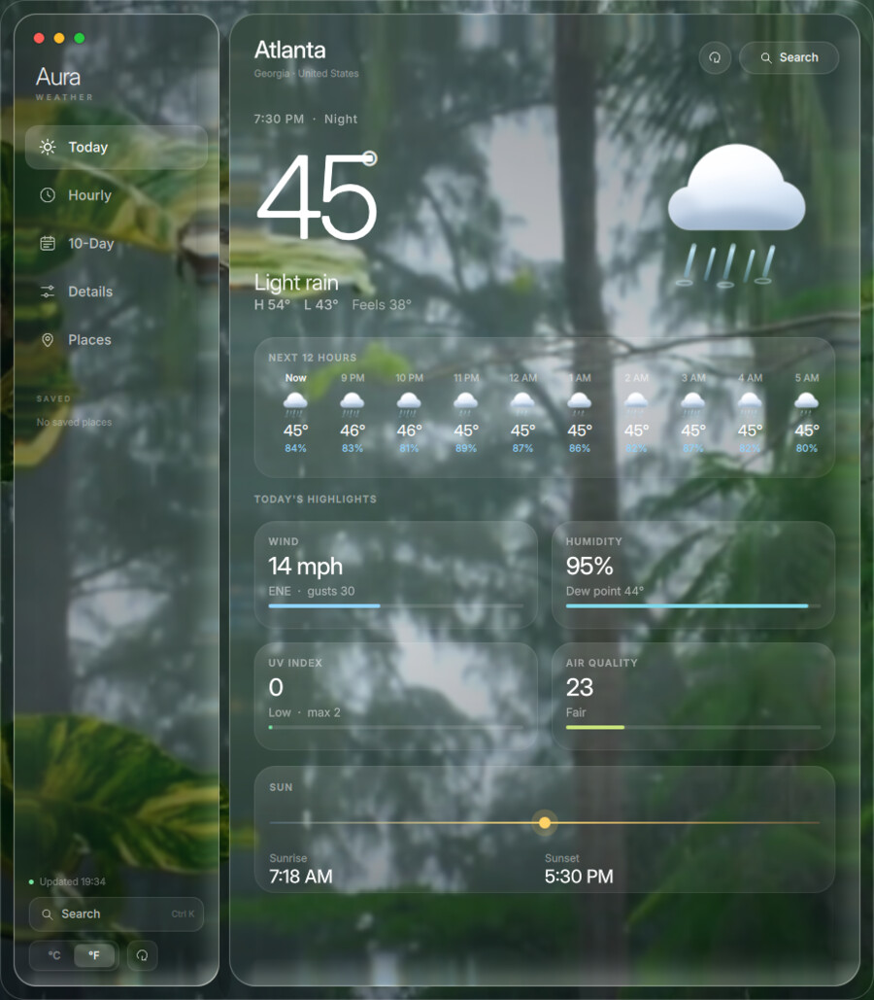
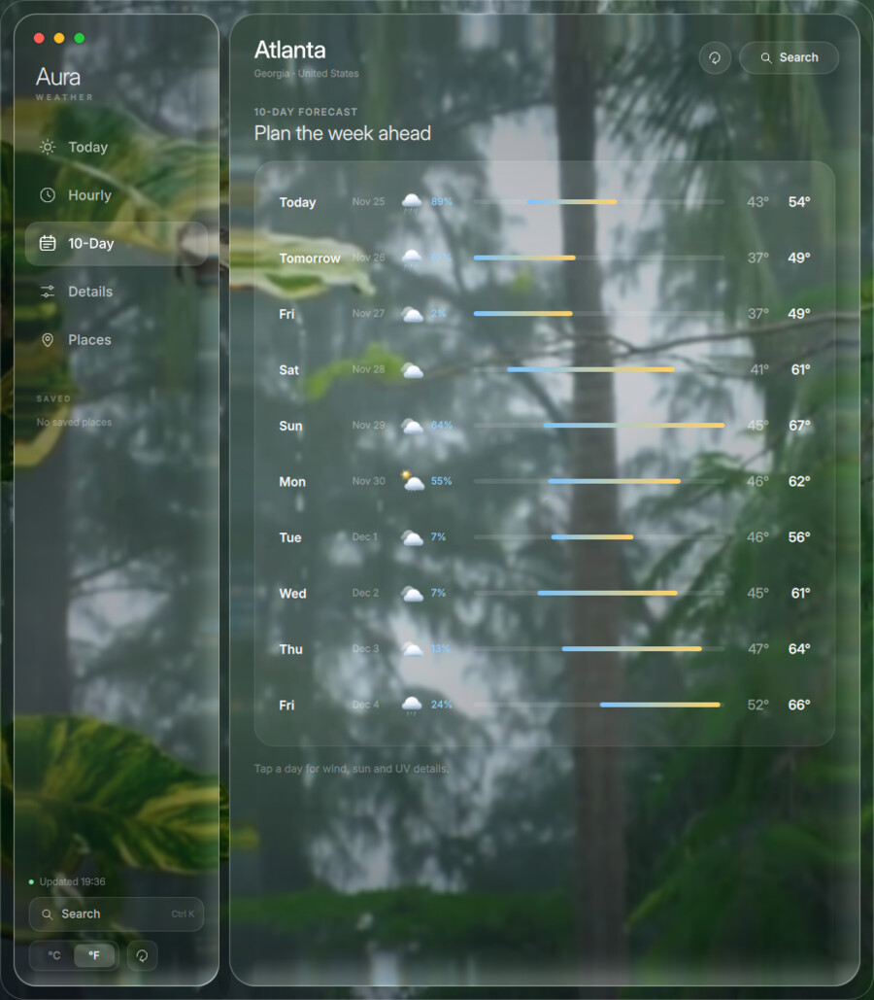
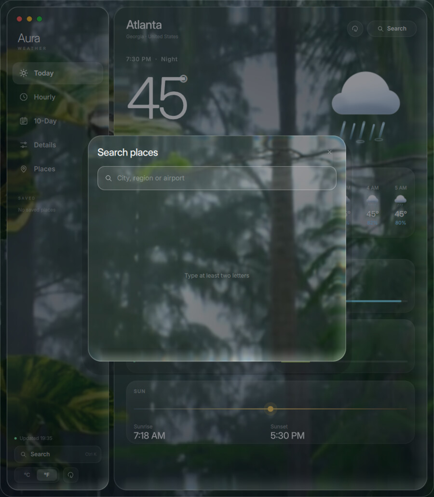

<p align="center">
  
</p>

<h1 align="center">Aura</h1>

<p align="center">
  <strong>Weather, beautifully.</strong><br>
  A native liquid-glass weather app for Linux, built with Qt Quick and PySide6.
</p>

<p align="center">
  <a href="https://github.com/falsecloud/aura/releases/latest"></a>
  <a href="https://github.com/falsecloud/aura/actions/workflows/release.yml"></a>
  
  
  <a href="LICENSE"></a>
</p>

<p align="center">
  
</p>

Aura is a frosted, fluid desktop weather app that treats the forecast as a
scene rather than a table. It combines a real shader-based glass material with
weather-reactive video backdrops, a clipped sliding page deck, and motion on
almost every control — not just fades.

The interface is native Qt Quick, so it feels at home on Wayland or X11, and
the whole app works without an API key.

## Features

- **Real liquid glass.** `qml/Glass.qml` uses a signed-distance-field bevel,
  chromatic dispersion, a Fresnel rim, a pointer lens, and a nine-tap Gaussian
  blur compiled to `qml/shaders/glass.frag.qsb`.
- **Weather-reactive atmosphere.** Looping footage, animated WebP stills, and
  a mood grade change with the current conditions; the poster frame covers the
  hand-off while the next loop loads.
- **Fluid page navigation.** Today, Hourly, 10-Day, Details, and Places live in
  a clipped slide deck. The glass nav pill glides between items instead of
  each item highlighting itself.
- **Motion that carries state.** Cards rise and settle, 10-day rows morph open,
  range bars resize, the wind needle turns, weather icons cross-fade, and
  controls scale on hover and press.
- **Hourly detail.** A readable temperature curve, rain probability, wind, and
  a next-12-hours strip.
- **10-day planning.** Temperature ranges, precipitation, expandable
  wind/sun/UV detail, and a day-by-day layout.
- **Live conditions.** Wind, humidity, dew point, visibility, pressure, UV,
  air quality, sunrise and sunset.
- **Places and units.** Search any city, region, or airport; save favorites;
  use approximate IP location; switch °C/°F.
- **No accounts, no keys, no telemetry.** Forecasts come from Open-Meteo and
  saved places stay in your local Qt settings.

<p align="center">
  
  &nbsp;
  
</p>

## Installation

### Releases

Every tagged release is built by GitHub Actions and published on the
[Releases](https://github.com/falsecloud/aura/releases/latest) page. The
release assets are self-contained — Python and Qt do not need to be installed.

| Format | Best for | Asset |
| --- | --- | --- |
| **AppImage** | Any modern glibc Linux | `Aura-<version>-x86_64.AppImage` |
| **APT repo** | Debian, Ubuntu, Linux Mint, Pop!_OS | `apt install aura-weather` |
| **deb** | Debian, Ubuntu, Linux Mint, Pop!_OS | `aura-weather_<version>_amd64.deb` |
| **rpm** | Fedora, RHEL, openSUSE | `aura-weather-<version>-1.x86_64.rpm` |
| **pacman** | Arch, Manjaro, EndeavourOS | `aura-weather-<version>-1-x86_64.pkg.tar.zst` |
| **tarball** | Portable/manual install | `Aura-<version>-x86_64.tar.gz` |

Check the release page for the exact current filenames and checksums.

#### AppImage

```bash
chmod +x Aura-*-x86_64.AppImage
./Aura-*-x86_64.AppImage
```

If your system does not have FUSE:

```bash
./Aura-*-x86_64.AppImage --appimage-extract-and-run
```

#### Debian / Ubuntu (APT repository)

Aura is available from a signed APT repository. Add the repository key and
source, then install it like any other package:

```bash
sudo install -d -m 0755 /etc/apt/keyrings
curl -fsSL https://falsecloud.github.io/aura/aura-archive-keyring.gpg \
  | sudo tee /etc/apt/keyrings/aura.gpg >/dev/null
echo "deb [signed-by=/etc/apt/keyrings/aura.gpg] https://falsecloud.github.io/aura stable main" \
  | sudo tee /etc/apt/sources.list.d/aura.list
sudo apt update
sudo apt install aura-weather
```

Then launch **Aura** from your application menu, or run:

```bash
aura
```

The repository is also rebuilt for future GitHub releases. It is a signed
third-party repository, not part of Debian's official archive; official Debian
inclusion requires a Debian maintainer and archive review.

#### Debian / Ubuntu (direct .deb)

```bash
sudo apt install ./aura-weather_*_amd64.deb
```

#### Fedora / RHEL

```bash
sudo dnf install ./aura-weather-*-1.x86_64.rpm
```

#### openSUSE

```bash
sudo zypper install ./aura-weather-*-1.x86_64.rpm
```

#### Arch Linux

```bash
sudo pacman -U aura-weather-*-1-x86_64.pkg.tar.zst
```

The pacman package is built from the same self-contained bundle as the other
release formats. It only needs a base Arch install with the usual desktop
libraries; Python and Qt are bundled inside the package.

The source-based AUR packaging is maintained in [`packaging/aur`](packaging/aur).
It uses Arch's `pyside6` and Qt 6 packages and installs the application under
`/opt/aura-weather`.

#### Portable tarball

```bash
tar -xzf Aura-*-x86_64.tar.gz
./Aura/Aura
```

The extracted folder must stay together because the executable uses the
adjacent `_internal` directory for Qt, QML, media, and its Python runtime.

### From source

Aura needs **Python 3.10+**, **PySide6 6.8+**, and a working **Vulkan** driver.
The glass shader is a real `ShaderEffect`; the app defaults to Qt's Vulkan RHI
backend instead of OpenGL.

Arch Linux:

```bash
sudo pacman -S python python-pyside6 qt6-multimedia qt6-declarative qt6-wayland
git clone https://github.com/falsecloud/aura.git
cd aura
./run.sh
```

Debian / Ubuntu:

```bash
sudo apt install python3 python3-venv libxcb-cursor0 libgl1 libegl1 \
  libxkbcommon-x11-0 libgstreamer1.0-0 libgstreamer-plugins-base1.0-0
git clone https://github.com/falsecloud/aura.git
cd aura
python3 -m venv .venv
. .venv/bin/activate
pip install -r requirements.txt
./run.sh
```

Other distributions: install Python, a Vulkan driver, the Qt 6
Multimedia/QML runtime, and the XCB cursor library, then use the same venv
commands.

## Using Aura

- **Ctrl+K** opens place search. **Esc** closes it.
- Click a page in the sidebar to move through Today, Hourly, 10-Day, Details,
  and Places.
- The search overlay accepts a city, region, or airport; results are geocoded
  through Open-Meteo.
- Click a saved place to switch to it. Use the star/remove button on a saved
  row to manage the list.
- The location button requests your approximate location. Aura first asks
  `ipwho.is`, then reverse-geocodes through BigDataCloud; no account is needed.
- The °C/°F control updates every page immediately.
- Click a 10-day row to expand wind, sun, and UV details.
- Settings and saved places live in `~/.config/Aura/Weather.conf` on Linux.

## How it is built

| Path | Purpose |
| --- | --- |
| `main.py` | Qt application entry point and QML bootstrap |
| `backend.py` | Open-Meteo/BigDataCloud/ipwho.is networking, forecast shaping, QSettings |
| `qml/Main.qml` | Window, sidebar, page deck, search state, header |
| `qml/Glass.qml` | Reusable liquid-glass material and pointer lens |
| `qml/shaders/glass.frag` | GLSL source for the refraction shader |
| `qml/shaders/glass.frag.qsb` | Compiled shader shipped at runtime |
| `qml/*.qml` | Today, Hourly, 10-Day, Details, Places, and shared widgets |
| `assets/` | App icon, navigation icons, weather icons, sheen texture |
| `media/` | Weather loops, poster frames, and animated sharp layers |
| `packaging/` | PyInstaller spec, Linux package builders, packaging assets |
| `.github/workflows/release.yml` | Tag-driven Linux builds and GitHub Releases |

The original browser prototype (`index.html`, `app.js`, `styles.css`,
`icons.js`) is kept in the repository for reference; it is not part of the
native build or the release packages.

### Data and privacy

- Forecast, air quality, and geocoding: [Open-Meteo](https://open-meteo.com/)
- IP location: [ipwho.is](https://ipwho.is/)
- Reverse geocoding: [BigDataCloud](https://www.bigdatacloud.com/)
- Weather footage: [Mixkit](https://mixkit.co/)

Aura has no analytics, telemetry, account system, or API keys. It sends the
forecast coordinates to those services and stores saved places and units
locally. Network access is required to refresh weather; the bundled video and
icon assets work offline.

## Building release packages

Build the self-contained bundle first:

```bash
python3 -m venv .build-venv
. .build-venv/bin/activate
pip install -r packaging/requirements-build.txt
python -m PyInstaller --clean --noconfirm packaging/aura.spec
```

Then use the package scripts:

```bash
bash packaging/make-portable.sh
bash packaging/make-deb.sh       # dpkg-deb
bash packaging/make-rpm.sh       # rpmbuild
bash packaging/make-arch.sh      # bsdtar + zstd
APPIMAGETOOL=/path/to/appimagetool bash packaging/make-appimage.sh
```

`bash packaging/build-all.sh` runs all of the above, but the host must have
the matching packaging tools. Outputs land in `release/`.

The release workflow builds on Ubuntu 22.04 with Python 3.12, PySide6 6.8.3,
and PyInstaller 6.11.1. To cut a release:

```bash
./scripts/bump-version 1.1.0   # optional helper; updates VERSION
git tag v1.1.0
git push origin v1.1.0
```

The tag must match `VERSION` (`v$(cat VERSION)`). The workflow builds the five
assets, writes `SHA256SUMS`, and publishes the GitHub Release. A manual
`workflow_dispatch` run builds and uploads the artifacts without publishing.

## Troubleshooting

**The window is black or the glass panels are missing.** Aura defaults to the
Vulkan Qt Quick backend because the refraction shader needs it. Install your
GPU's Vulkan driver (`mesa-vulkan-drivers` on Debian/Ubuntu, `vulkan-radeon`
or `vulkan-intel` on Arch, or the proprietary NVIDIA driver). Confirm Vulkan
works with `vulkaninfo`.

**The AppImage will not start because of FUSE.**

```bash
./Aura-*-x86_64.AppImage --appimage-extract-and-run
```

**Weather videos do not play.** Qt Multimedia needs a working GStreamer or
FFmpeg backend and the corresponding codecs. On minimal installs, install
`gstreamer1.0-plugins-good` / `gst-plugins-good` (names vary by distro).

**The forecast does not refresh.** Aura needs outbound HTTPS access to
`api.open-meteo.com`, `air-quality-api.open-meteo.com`,
`geocoding-api.open-meteo.com`, `api.bigdatacloud.net`, and `ipwho.is`.

**Where are my places stored?** In `~/.config/Aura/Weather.conf`. Removing that
file resets saved places and the unit preference.

## Development notes

- The app is intentionally frameless and uses `Qt.Window | Qt.FramelessWindowHint`.
- Glass is drawn with a `ShaderEffect`; changing the shader requires rebuilding
  `qml/shaders/glass.frag.qsb` with `qsb`.
- Motion uses Qt Quick `Behavior`/`Transition` animations with `OutQuint`,
  `OutCubic`, and subtle `OutBack` overshoot. Reuse those rather than adding
  one-off timers.
- The page deck keeps all pages instantiated and moves them with `x` and
  `scale`; this is what makes the page changes predictable and fluid.

## License

MIT — see [LICENSE](LICENSE).

Weather data by Open-Meteo. Built with Qt 6 and PySide6.
